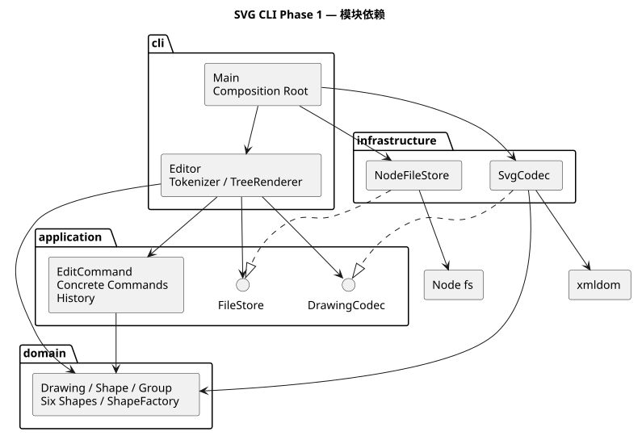
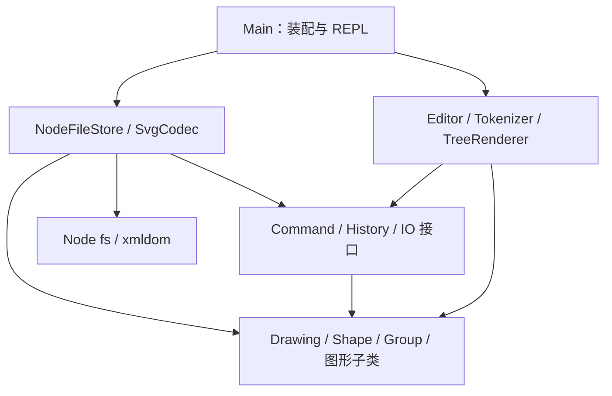

# SVG 编辑器 CLI：架构、过程与验收报告

本报告对应 Lab1 Phase 1。项目用 TypeScript 实现，可编辑 rect、circle、ellipse、line、text 和 g，保存结果可由浏览器直接打开。`box` 是下一阶段的插件目标，本阶段按要求拒绝创建。

## 一、架构方案

### 1. 模块划分

| 目录                  | 职责                                                             | 代表类                                                                 |
| --------------------- | ---------------------------------------------------------------- | ---------------------------------------------------------------------- |
| `src/domain/`         | 图形身份、几何行为、树结构、画布和图形构造；不读文件、不解析命令 | Shape、Rect、Circle、Ellipse、Line、Text、Group、Drawing、ShapeFactory |
| `src/application/`    | 一次编辑的业务行为、撤销重做事务、外部能力接口                   | EditCommand、各具体 Command、History、FileStore、DrawingCodec          |
| `src/infrastructure/` | SVG XML 与领域对象的转换、UTF-8 文件读写                         | SvgCodec、NodeFileStore                                                |
| `src/cli/`            | 参数解析、命令路由、文本显示、REPL 与依赖装配                    | Tokenizer、Editor、TreeRenderer、Main                                  |
| `test/`               | 行为、真实进程、文件 IO、架构依赖测试                            | Node 原生 test runner                                                  |
| `examples/`           | 可回放脚本、生成的 SVG、实际输出、外部 SVG 输入                  | flowchart.txt、other.svg                                               |
| `doc/`                | 方案、过程、验证与需求追踪                                       | 本文件、architecture.puml、requirements.md                             |

组件图的 PlantUML 源文件为 [architecture.puml](architecture.puml)，渲染结果如下（仓库中直接可见）：



下列同源图便于在支持 Mermaid 的阅读器中查看：



### 2. 设计模式的选择与落地

**Command（必选）**：每个编辑行为由 `EditCommand` 子类表达。例如 `MoveCommand` 封装目标 id 和位移，`GroupCommand` 封装新容器及待收编 id。Editor 负责把输入转换成命令，History 只通过统一的 `execute` 执行，不解析命令名字。

**Memento 与事务**：History 在文档克隆上执行命令，成功后才替换当前文档、写入前后快照。undo/redo 恢复快照，因此一次 group、delete 或递归 scale 都只有一个撤销单元；中途失败不会留下半棵树，也不会清空 redo。文档 IO 成功后清空历史并设置屏障，下一次编辑成功才解除。代价是每次编辑需要 O(n) 的快照空间与复制时间；本阶段的小型文档可以接受，未来大文档可换为差量撤销。

**Composite**：Shape 对叶子与 Group 提供相同的 move、scale、set、children 和 clone 行为。叶子通过各自几何字段定义移动和缩放；Group 递归访问 children。业务命令无需按图形标签分支。普通 g 的 fill/stroke 使用 SVG 属性继承，不把子节点显式颜色覆盖掉。

**Factory 与依赖倒置**：ShapeFactory 集中创建六种形状；文件系统和序列化以接口注入 Editor，测试可使用内存文件。XML 库不会进入领域层。

**按名字分派仅有两处，均列为后续重构项**：

1. `Editor.routes`：命令名到处理器的映射。下一阶段可改为命令提供者注册；目前不提前建立插件生命周期框架。
2. `ShapeFactory.types`：图形类型名到构造器及参数表的映射。下一阶段应抽取 ShapeProvider，支持插件注册、序列化标记和专属属性。

读回 text 内容通过多态 `importText`，不增加第三处标签分发。Group 的类型判断只用于检查容器能力与组合结构。

### 3. 依赖方向规则

| 模块           | 可以依赖                              | 理由                                  |
| -------------- | ------------------------------------- | ------------------------------------- |
| domain         | domain                                | 核心模型独立于 UI、文件和 XML 库      |
| application    | application、domain                   | 编辑规则只操作领域行为，IO 以接口表示 |
| infrastructure | application 接口、domain、Node/XML 库 | 适配器实现端口；外部变化在此收敛      |
| cli（除 Main） | cli、application、domain              | 解释输入、调用业务、展示结果          |
| Main           | cli、infrastructure                   | 唯一装配入口，可明确选择具体适配器    |
| test           | 所有被测模块                          | 验证跨层行为，不被生产代码反向引用    |

禁止 domain/application 导入 CLI 或 infrastructure；禁止 domain 导入 application 或 Node IO。`test/architecture.test.mjs` 检查核心层的这些规则；Main 对具体适配器的依赖属于已声明的装配职责，不是隐含例外。

### 4. 变化点假设

| 可能变化               | 预留与取舍                                                                                     |
| ---------------------- | ---------------------------------------------------------------------------------------------- |
| 增加 box 等复合图形    | Shape 多态与 Group 组合结构已存在；工厂注册表待抽成 Provider。本次不声称已实现零内核改动插件化 |
| CLI 之外增加 GUI/Agent | Command 与领域层可复用；字符串解析和树显示留在 cli                                             |
| 换文件系统或存储位置   | FileStore 接口可替换；文件适配器使用临时文件再 rename，减少写入失败造成的破坏                  |
| XML 解析库变化         | DrawingCodec 隔离解析器；本次升级已通过编译及往返测试验证                                      |
| 文档规模增大           | 当前快照历史简单可靠；没有提前引入差量补丁或持久化树，避免额外复杂度                           |
| 输出需要更精确对齐     | TreeRenderer 独立；目前保留树线、id、全部已设置属性，不要求列宽与示例逐字相同                  |

## 二、过程记录

以下以我的项目视角记录本次与 AI 助手协作的真实过程。实现、命令执行与测试由 AI 完成；不把 AI 的自查伪写成我已亲自运行或审阅。

| 迭代         | 发现与确认                                                            | 处理与证据                                                                                                   |
| ------------ | --------------------------------------------------------------------- | ------------------------------------------------------------------------------------------------------------ |
| 需求读取     | 我要求完整完成作业、先建仓、禁止一次性大提交；文档明确 box 不属本阶段 | AI 完整读取原文，先创建私有 GitHub 仓库，再按工程、模型、图形、命令、IO、CLI 逐步提交                        |
| 撤销边界     | save 与 canvas 修改尺寸也会设置 IO 屏障，容易只处理 init/read         | History 单独建模 barrier；测试同时覆盖成功 IO、失败 IO 和下一次编辑解禁                                      |
| XML 依赖     | 安装器报告原选 0.8.11 存在严重问题                                    | 独立升级到 0.9.12，编译发现 localName 可空，另一次提交修复类型兼容；npm audit 复查                           |
| 启动依赖     | 当前环境 tsx 启动时报 uv_os_get_passwd 错误                           | 改为 tsc 编译后由 Node 执行；移除 tsx/esbuild，单独提交依赖修复                                              |
| 名称分派检查 | 导入实现曾通过 tag 判断 text，会形成第三处名称分派                    | 把读取文本放到 Shape.importText/Text.override，独立重构并复测                                                |
| 测试自身问题 | 模拟写失败开关未复位；流程图总元素误计为 9                            | 修正测试夹具和预期；实际为 3 个 g、2 个 rect、2 个 text、1 条 line，共 8 个，与原文一致                      |
| Git 传输     | Windows Git 的 TLS/凭据存储失败；不能把本地提交冒充推送成功           | 用已连接 GitHub 插件按本地提交顺序重建远程提交链，保留提交主题与文件范围；API 生成的远程 SHA 与本地 SHA 不同 |
| 安装复现     | 环境没有全局 npm，默认 npm cache 路径也不可写                         | 使用临时 npm 工具、工作区缓存和隔离目录验证；这些环境临时工具不作为项目依赖提交                              |

修订记录：模块结构保持最初的四层方案；运行方式从 tsx 改为编译后执行；导入文本从标签判断改为多态；锁文件统一以 npm 为交付安装入口。提交历史记录这些变化，不把过程整理成一次完成的假象。

## 三、一致性自查

### 1. 实际模块与方案是否一致？

一致：src 下为 domain、application、infrastructure、cli。每个类单独文件，文件名等于类名；两个端口接口也独立成文件。新增 test、examples、doc 为验证和交付目录。工厂参数表只负责构造，不承担几何运算；各形状的状态由 Shape 私有字段封装，命令通过方法修改。

### 2. 依赖方向是否违反规则？

核心层自动检查通过。抽样：MoveCommand → Drawing/EditCommand；Drawing → Shape/Group；SvgCodec → DrawingCodec/领域类/xmldom；NodeFileStore → FileStore/Node；Main → Editor/两个适配器。未发现反向依赖。两个名称注册表已明确登记为下一阶段重构项。

## 四、质量保证手段

### 如何确认功能完整

需求逐条对应 [requirements.md](requirements.md)。测试覆盖正常路径、错误路径、树结构恢复、所有几何类型、真实 stdin CLI 和真实文件系统。`examples/flowchart.txt` 回放实际生成 [flowchart.svg](../examples/flowchart.svg)，完整输出见 [flowchart.transcript.txt](../examples/flowchart.transcript.txt)。浏览器可直接打开 SVG 验证文字和节点位置。

### 验证命令

```sh
npm ci
npm run check
npm audit --audit-level=low
npm run cli < examples/flowchart.txt
```

实际验证结果与环境说明见 [verification.md](verification.md)。测试通过说明已覆盖的行为可靠，不等于对任意外部 SVG 或任意尺寸文档的形式化证明。

### 明确的行为决策与限制

- group 保持原文档深度优先顺序，插入到第一个被选图形的原父级及原位置；不按参数顺序重新排序。该规则补足跨父容器场景的未指定细节。
- front 移到同级 SVG 子节点末尾，渲染在最上；back 移到开头。ungroup 只允许非根级 g，并在原槽位展开子节点。
- init/canvas 接受零个或两个尺寸参数；省略尺寸时 init 为 800×600。所有数值必须有限，尺寸/半径不可负，画布与缩放因子必须正。
- undo/redo 成功时回显完成摘要，不逐字复现作业 transcript 的自然语言。tree/show 内联字段完整但不做固定列宽排版。
- 外部 SVG 读取范围为本阶段六种元素及 set 白名单中的属性；不支持 path、transform、CSS、defs、tspan、带单位的尺寸等完整 SVG 特性。遇到不支持的内容报错且保留原文档，避免静默丢失。DTD/自定义实体被拒绝。`data-kind` 可忽略，以普通 g 降级读回未来 box 的普通子结构。
- 本次未实现后续插件 box，也未伪造插件能力。未给出课程截止时间，不能证明 final 标签早于截止；应由课程平台时间核对。

## 五、提交与交付

仓库：<https://github.com/ButterYu/svg-editor-cli-lab1>（公开）。仓库原名 svg-editor-cli-phase1，按我的要求更名并公开。功能、测试、依赖修复、格式化、示例与报告分开记录。最终以远程 `final` 标签定位交付版本；不以本地 SHA 替代远程验收依据。

## 六、补做的逐提交验证（2026-10-26）

### 为什么补做

我在检查提交历史后，要求 AI 补齐每个历史提交的构建、测试记录，保留真实历史并继续小批次提交。这是交付后的改进：它补充可复核证据，**不能倒推为开发时每步都有测试或 CI**，也不能消除原有中间版本的失败。

### 如何验证与发现了什么

AI 从公开 GitHub 仓库重新克隆，固定原 final 提交 `6de1781a1929e58cf455e679970c5d970da40c5d`，按顺序导出它的全部 26 个祖先版本（含自身），分别安装依赖并执行各版本原有的 build、test、format:check 和 check。没有修改旧源码，没有把后来的测试补到旧版本里。

完整结果、逐条日志、执行时间、依赖解析与方法限制见 [历史回溯验证](history-audit/README.md)。Windows / Node 24 的本次结果为：

| 项目     | 通过 | 失败 | 当时无测试 | 不适用 |
| -------- | ---- | ---- | ---------- | ------ |
| 构建     | 22   | 3    | —          | 1      |
| 测试     | 14   | 1    | 10         | 1      |
| 格式检查 | 3    | 22   | —          | 1      |
| 综合检查 | 3    | 22   | —          | 1      |

失败包括：初始化阶段没有源码；加入 SVG 解析后的两个版本存在 nullable localName 类型问题；集成测试初次加入时把 8 个元素误写为 9。修复分别发生在原有后续提交中，这次没有把它们抹掉。很多较早版本的综合检查失败来自尚未完成格式化或目录尚不存在，应与功能测试失败区分。

核验工具第一版还发现了“没有测试文件，但 Node 以 0 退出”的情况。AI 修正当前核验器并补了两组测试；记录采用独立解释层标注“尚无测试”，原始输出、原始索引和当时执行的核验器源码原样保留。哈希校验可检查日志及依赖锁是否被修改。

### 这次改进的真实边界

- 回溯记录于本次补做时生成，记录的执行时间与原提交时间分别保存，原有 26 个 SHA、源码树与时间戳保持不变。
- 没有 npm 锁文件的版本使用新安装，并保存本次实际解析出的锁；没有强制使用原 pnpm 锁，因此不能称为历史依赖的完全复现。安装禁用生命周期脚本。详见方法说明。
- Windows 上旧 tsx 账户查询错误属于环境限制；不据此声称所有平台的相同版本都无法测试。
- 当前源码新增两组核验工具测试，总计 13 组；原 final 的应用测试数仍为 11，不能把新增测试算作旧版本已具备。
- 原 final 将以 `final-before-history-audit-20261026` 保留；`final` 更新到包含本次报告和证据的新提交。这里只移动交付引用，不重写开发历史。

### 后续如何避免相同问题

常规 CI 继续对每次推送运行安装、编译、测试、格式检查和依赖审计；新增 `npm run verify:audit` 校验原 26 个提交的祖先顺序、源码树、原时间戳、日志哈希和实际依赖锁。本次新增提交各自触发 CI，记录入口见 [新增提交的 CI 对照](follow-up-ci.md)。

另有手动工作流 `Retrospective history audit`，允许指定精确截止 SHA，在 Ubuntu / Node 22 上重新导出逐版本报告并保存 Actions artifact。它与开发期间 CI 明确分开命名，不伪装成历史上曾经执行的检查。
